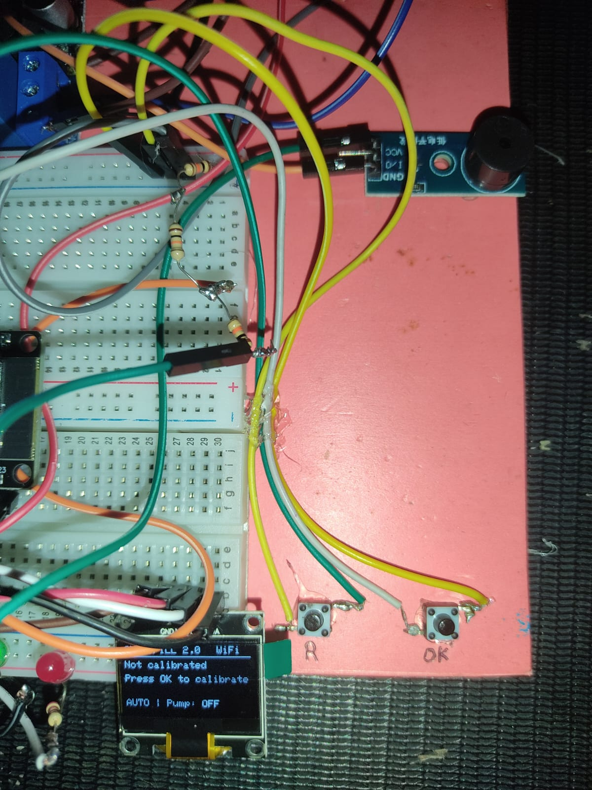
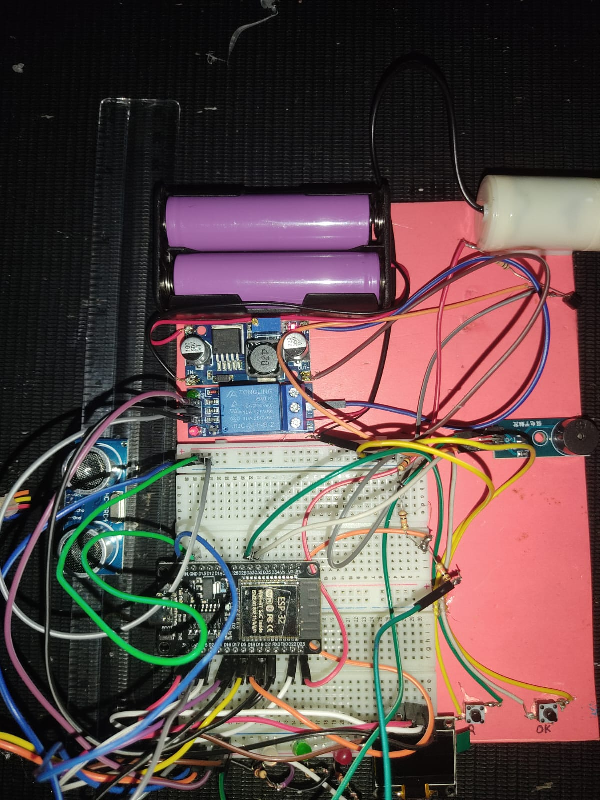
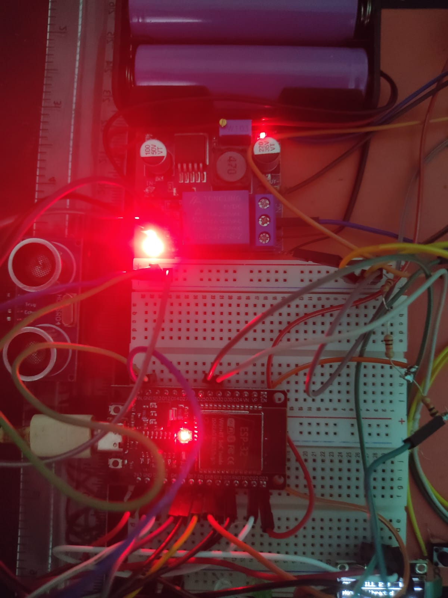
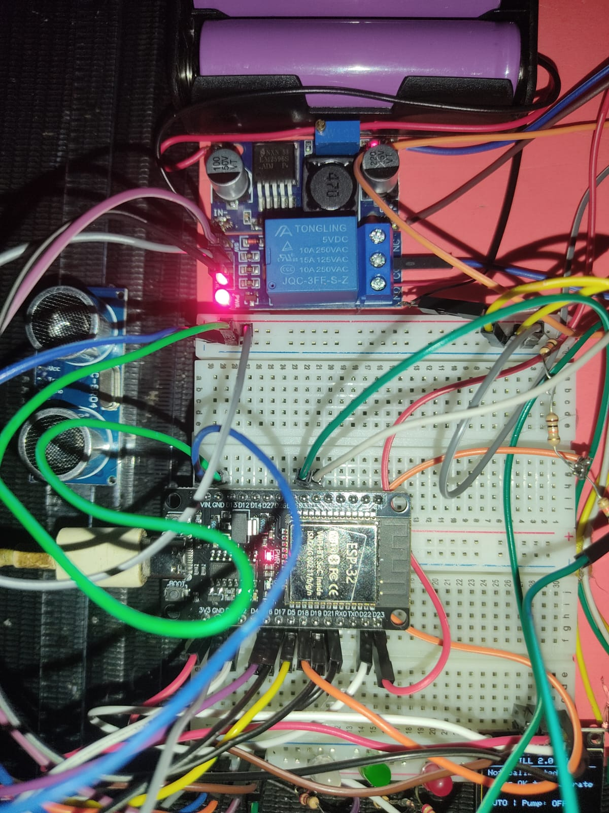

# 💧 SmartFill 2.0

<p align="center">
  <strong>Smart water monitoring · ESP32 pump automation · HydroLevel connectivity</strong><br>
  <a href="https://htmlpreview.github.io/?https://github.com/Hi-iamAT/SmartFill_2.0/blob/main/connection.html">🌐 Open the connection guide</a>
  · <a href="https://htmlpreview.github.io/?https://github.com/Hi-iamAT/SmartFill_2.0/blob/main/device-setup.html">🔌 HydroLevel API setup</a>
  · <a href="https://github.com/Hi-iamAT/SmartFill_2.0/blob/main/connection.png">🖼️ Wiring diagram</a>
</p>

<p align="center">
  
  
  
  
</p>

> [!IMPORTANT]
> GitHub displays `.html` files as source code. The quick links above use GitHub HTML Preview to render the pages directly from this public repository, without waiting for GitHub Pages. Changes must be pushed to `main` before those links show the updated guide.

SmartFill uses an ESP32, an HC-SR04 ultrasonic sensor, an OLED, indicator LEDs, a buzzer, and a relay to monitor a tank and control its pump. Level measurement and pump safety run on the ESP32. Wi-Fi is used to send readings to the SmartFill server and receive remote commands; automatic control continues locally when the network is unavailable.

**🌐 Project website (GitHub Pages):** [SmartFill home](https://hi-iamat.github.io/SmartFill_2.0/) · [Connection guide](https://hi-iamat.github.io/SmartFill_2.0/connection.html) · [Device/API setup](https://hi-iamat.github.io/SmartFill_2.0/device-setup.html). These links require Pages deployment; use the preview links at the top in the meantime.

> [!WARNING]
> The supplied `connection.png` is a component-level reference, but some GPIO routes differ from the current firmware. Use the pin table below and in the [rendered connection guide](https://htmlpreview.github.io/?https://github.com/Hi-iamAT/SmartFill_2.0/blob/main/connection.html) as the source of truth when wiring this sketch.

## 📁 Project files

- `water_meter/water_meter.ino` — ESP32 firmware.
- `water_meter/secrets.h.example` — configuration template; copy it to `water_meter/secrets.h` and enter credentials.
- `connection.png` — supplied wiring illustration.
- `connection.html` — detailed connection instructions and diagram.
- `device-setup.html` — rendered HydroLevel device registration and API connection guide.
- `index.html` — project website landing page.
- `assets/image-1.jpeg` … `assets/image-5.jpeg` — project build photos.

## 📸 Build photos

These photos document the prototype assembly and powered operation. They are visual references; the firmware pin map and connection guide define the current wiring.

| Prototype assembly | Prototype assembly | Powered indicators |
|---|---|---|
|  |  |  |

| Sensor and controller wiring | Prototype wiring detail |
|---|---|
|  |  |

## ⚙️ What it does

### Water measurement

The firmware takes five HC-SR04 readings, discards readings outside the 2–400 cm range, and uses the median of the valid readings. It calculates the water level from the measured distance and a saved empty-tank reference. The sensor is mounted above the tank, pointing down at the water; a 6 cm rim offset is reserved as unusable space to keep the water below the sensor’s blind zone.

The OLED shows calibration status, level percentage, water height, free space, Wi-Fi status, control mode, and actual pump state. The green, blue, and red LEDs turn on at the configured 25%, 50%, and 75% thresholds; the buzzer pulses at the configured buzzer threshold (default 90%).

### Pump operation

- **AUTO (default):** starts the pump when the measured level is at or below 10% and stops at 50%. This hysteresis is hard-coded in the sketch, so automatic control does not depend on Wi-Fi.
- **MANUAL:** applies the server’s ON/OFF command. A manual ON command expires if no successful command poll arrives for 30 seconds.
- **Local safeguards:** pump output is set OFF at boot and is stopped when the sensor reading is invalid, calibration is missing, the level reaches 50%, or continuous runtime reaches 15 minutes.
- **Buttons:** a short press of OK begins empty-tank calibration. Hold RESET for 2.5 seconds to erase calibration. A short RESET press while in MANUAL cancels the current ON request locally.

The current implementation has one 50% local stop threshold for both AUTO and MANUAL. The remote settings adjust the display/alarm thresholds and upload interval; they do not change the firmware’s 10% AUTO start, 50% stop, or 15-minute runtime safety limits.

### Server communication

When online, the ESP32 posts readings to `/api/readings` (default interval 30 seconds) and polls `/api/device-command` every 5 seconds. The reading includes sensor measurements, Wi-Fi signal strength, firmware version, control mode, and pump state. Remote commands are requested by the device and still pass through local safety checks before the relay changes.

## 🔧 Wiring and connections

Open the [rendered SmartFill connection guide](https://htmlpreview.github.io/?https://github.com/Hi-iamAT/SmartFill_2.0/blob/main/connection.html) for the supplied diagram, pin-by-pin table, power guidance, and first power-up sequence.

| Device | ESP32 connection | Notes |
|---|---|---|
| HC-SR04 VCC / GND | 5V / GND | Use a regulated 5 V supply appropriate to the sensor. |
| HC-SR04 TRIG | GPIO 5 | 3.3 V ESP32 output is used for the trigger. |
| HC-SR04 ECHO | GPIO 18 through divider | HC-SR04 ECHO can be 5 V. Use a divider; see the connection guide. |
| SSD1306 OLED SDA / SCL | GPIO 21 / GPIO 22 | I²C, address `0x3C`; connect VCC and GND per module rating. |
| Green / blue / red LEDs | GPIO 15 / GPIO 16 / GPIO 17 | Each LED needs its own series resistor (220–330 Ω). Confirm LED polarity. |
| Active buzzer module | GPIO 23 via driver | Firmware drives HIGH for ON. Use the NPN driver arrangement described in the guide. |
| OK / RESET buttons | GPIO 32 / GPIO 33 | Each momentary switch connects its GPIO to GND; firmware uses `INPUT_PULLUP`. |
| Relay module IN | GPIO 19 | Firmware currently defines `RELAY_ACTIVE_LOW = false`; verify the actual relay board before connecting the pump. |

The sketch’s exact pin definitions are at the top of `water_meter/water_meter.ino`. The supplied diagram includes a battery/charger/buck-converter arrangement and routing that may not match this sketch; follow the guide’s current map. Never connect a pump directly to an ESP32 pin. Use a correctly rated relay and a separate supply sized for the pump’s voltage and startup current.

## 🚀 Setup

1. In Arduino IDE, select an ESP32 Dev Module-compatible board and install **ArduinoJson 7**, **Adafruit GFX Library**, and **Adafruit SSD1306**.
2. Copy `water_meter/secrets.h.example` to `water_meter/secrets.h`.
3. Set `WIFI_SSID`, `WIFI_PASSWORD`, `SERVER_URL`, `DEVICE_CODE`, and `DEVICE_API_KEY`. Register the device in the SmartFill service and copy its API key when shown. Do not commit `secrets.h`.
4. Check the pin map and relay polarity, then flash `water_meter/water_meter.ino`.
5. Open Serial Monitor at **115200 baud**. Empty the tank and position the sensor. Press OK to begin calibration, then press OK again when the OLED/Serial prompt asks to save the empty reference. Calibration is stored in ESP32 preferences and survives reboot.
6. Test sensor display and relay behavior with the pump disconnected before connecting the pump supply.

## ☁️ Connect the ESP32 to HydroLevel

The firmware communicates with `https://hydrolevel.vercel.app` over HTTPS using the device API key. Create the device in HydroLevel first; the ESP32 does not create or register its own device.

1. Follow the [rendered HydroLevel device setup guide](https://htmlpreview.github.io/?https://github.com/Hi-iamAT/SmartFill_2.0/blob/main/device-setup.html), then open the HydroLevel website and go to **Devices**. Create/register a device for this ESP32 and copy its device code and API key when shown. The API key may only be shown once; keep it private.
2. Copy `water_meter/secrets.h.example` to `water_meter/secrets.h` and set:

   ```cpp
   #define SERVER_URL       "https://hydrolevel.vercel.app"
   #define DEVICE_CODE      "YOUR_DEVICE_CODE"
   #define DEVICE_API_KEY   "YOUR_DEVICE_API_KEY"
   ```

   Also enter the Wi-Fi SSID and password. Do not include a trailing slash in `SERVER_URL`.
3. Compile and flash the sketch. Open Serial Monitor at 115200 baud and confirm Wi-Fi connection and the device's measurements. Check the HydroLevel device page for incoming readings.
4. To use remote pump control, select MANUAL and issue ON/OFF from the HydroLevel interface. The site stores a command; the ESP32 polls for it about every 5 seconds. MANUAL ON expires if no successful poll arrives for 30 seconds. AUTO mode is local and continues without Wi-Fi.

### Device API exchange implemented by the sketch

- **Upload readings:** `POST https://hydrolevel.vercel.app/api/readings` with `Content-Type: application/json` and `X-API-Key: <device API key>`. The JSON includes `device_code`, `distance_cm`, `water_height_cm`, `water_level_percent`, `free_space_cm`, `sensor_valid`, `firmware_version`, `wifi_rssi`, `pump_status`, `control_mode`, and `pump_runtime_seconds` (and `container_id` when known).
- **Read commands:** `GET https://hydrolevel.vercel.app/api/device-command?device_code=<device code>` with `X-API-Key`. After receiving an update timestamp, the firmware also sends `X-Command-Updated-At` so the server can acknowledge the command version.
- **Apply configuration/commands:** a successful reading response can supply `interval_seconds`, `thresholds`, `empty_distance_cm`, `container_id`, and a `command` object. The command poll response supplies `mode`, `pump`, and `updated_at`. The firmware validates the command values and still applies local pump safeguards before switching the relay.

Example of the reading payload shape (values are illustrative):

```json
{
  "device_code": "ESP32_XXXX",
  "distance_cm": 28.4,
  "water_height_cm": 42.1,
  "water_level_percent": 59.8,
  "free_space_cm": 22.4,
  "sensor_valid": true,
  "firmware_version": "2.0.0",
  "wifi_rssi": -53,
  "pump_status": false,
  "control_mode": "AUTO",
  "pump_runtime_seconds": 0
}
```

The current firmware uses `tls.setInsecure()`, so it does not verify the HydroLevel HTTPS certificate. Replace that prototype setting with trusted certificate validation before deploying to an untrusted network. Keep the API key out of screenshots, public source control, and shared logs.

## 🌍 Publish the project website

The repository includes a GitHub Actions workflow that publishes the static guide files to GitHub Pages when changes are pushed to `main` or `master`. In the GitHub repository, open **Settings → Pages** and set the build/deployment source to **GitHub Actions**. Push the project to the repository and wait for the **Publish SmartFill guide** workflow to finish. Then the site is at `https://hi-iamat.github.io/SmartFill_2.0/`, the wiring page is at `https://hi-iamat.github.io/SmartFill_2.0/connection.html`, and the device/API guide is at `https://hi-iamat.github.io/SmartFill_2.0/device-setup.html`.

The workflow publishes only the HTML pages, README, diagram, and build photos; it does not publish the firmware or `secrets.h`.

## Calibration and measurement notes

- Mount the sensor level and securely above the maximum water surface, aimed away from tank walls, braces, and inlet streams.
- `SENSOR_TO_RIM_OFFSET_CM` is currently 6 cm. Adjust it to the measured sensor-face-to-safe-fill distance if the installation differs; keep the water surface outside the HC-SR04 blind zone.
- Calibrate with the tank empty and the sensor in its final position. A changed sensor mount or tank geometry requires recalibration.
- The `free_space_cm` value subtracts the 6 cm safety offset from measured distance. Level percentage uses the empty reference minus that offset as usable tank height.
- Firmware currently calls `tls.setInsecure()`. This skips HTTPS certificate verification and is suitable only for a controlled prototype; production deployment should configure trusted certificate validation.

## Troubleshooting

| Symptom | Check |
|---|---|
| OLED not found | SDA/SCL on GPIO 21/22, power, ground, and I²C address `0x3C`. |
| Sensor error or unstable level | Common ground, TRIG/ECHO orientation, ECHO divider, sensor mounting, and clear reflections from the water. |
| Pump acts inverted | Check relay module active level and change `RELAY_ACTIVE_LOW` only after testing with pump disconnected. |
| Pump remains off | Confirm calibration, valid sensor reading, level below the stop point, relay wiring, and that the 15-minute limit has not been reached. |
| No server updates | Check 2.4 GHz Wi-Fi availability, credentials, server URL, device code/API key, and Serial Monitor HTTP messages. Local AUTO control can still work offline. |

## Safety

Mains wiring and pump circuits can cause electric shock, fire, or equipment damage. Keep mains-side work isolated and have it performed by a qualified person. Use a relay module and power supply rated for the pump’s voltage, running current, and startup current; include suitable fusing and enclosure/strain relief. Keep low-voltage ESP32 wiring separated from mains. Test relay logic with the pump disconnected first.
